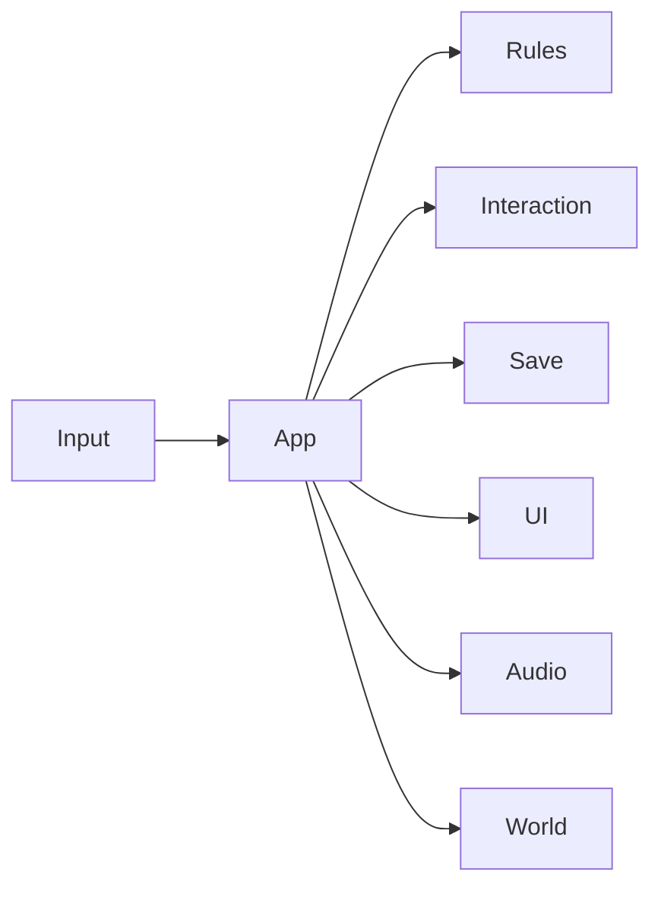

# Design: 既存の庭に水運びと谷の大気を加える

## Overview
v16の実モデルと衝突を維持し、単純な進行と印象的な風景を追加する。
公開サービスは作らず、ローカルで遊べる非公開の静的Webプロジェクトとして渡す。

## Boundary Commitments
今回が所有するのは水運びの進行、対話判定、進行保存、目的・所持表示、音、追加風景。
衝突と元GLB、人物・戦闘・村の拡張は境界外。許容依存は同梱Three.jsとWeb標準。
進行形式・対話座標・品質契約を変更した場合は単体・ブラウザの再検証を行う。

## Architecture
依存方向は 純粋な規則 → 保存・描画アダプター → appによる結合 → UI入力。
UI・音・風景は進行の正本を持たず、appが成功した遷移だけを全表示へ同期する。

| Layer | Choice | Reason |
|---|---|---|
| 実行 | ES Modules、Three.js 0.180.0 | 既存の同梱版を継承し、追加導入を不要にする |
| 状態 | 4状態の純粋な関数 | 不正順序や二重操作を描画抜きで検証する |
| 保存 | バージョン付きlocalStorage | 外部認証を増やさず中断復帰できる |
| 音 | Web Audioの短い合成音 | 新しい音声素材・ライセンスを不要にする |

## File Structure Plan
| Path | Responsibility | Requirements |
|---|---|---|
| dist/gameplay.js | 初期状態・遷移・目標・所持説明 | 1.1,1.2,1.3,1.4,1.5,2.2,2.3 |
| dist/interactions.js | 水平距離・向き・遮蔽による一対象選択 | 2.1,2.2 |
| dist/save.js | 版・型・状態検証、保存失敗からの復帰 | 3.3,3.4,3.5 |
| dist/environment.js | 空・霧・山並み・木立・風・水面 | 5.1,5.2,5.3,5.4 |
| dist/audio.js | ユーザー操作起動・ミュート・停止 | 3.1,4.5 |
| dist/quest-view.js | 桶の39部品の保持と所持・配置の同期 | 2.4 |
| dist/app.js | 同一対話入口、入力制御、全体結合、QA | 2.1,2.3,3.1,3.2,3.6,4.2,4.3,5.4 |
| dist/ui.js,index.html,style.css | 目的・持ち物・予告・再挑戦・設定 | 4.1,4.2,4.3,4.4,4.5,4.6 |
| tests、tools、reports、package.json | 新規テストと構文検査の入口、実操作・固定画角・非公開Gitの証拠 | 6.1,6.2,6.3 |

## Components and Interfaces
`gameplay.js`: `initialState()`, `transition(state,action)`は新状態と成否を返す。
状態は`bucket → empty → full → delivered`。操作は`pickup, fill, deliver`。
`save.js`: `loadProgress(storage)`は状態・保存有無・案内理由、`saveProgress(storage,state)`は成否を返す。
不正なJSON・null・配列・未知の版・不整合は初期状態へ。位置は保存せず安全な開始点へ戻す。
`interactions.js`: `selectTarget(player,yaw,targets,isOccluded)`は既定の水平距離1.6m以内、前方許容角、遮蔽なしの一対象かnullを返す。
距離は対象データで設定可能。今回の桶・井戸・配達先はすべて1.6mを使う。
予告とE・タッチ実行は同じ関数で再評価。遮蔽は身体目線から対象アンカーへ、家と井戸の境界を使う。
`environment.js`: `createEnvironment({scene,renderer,model,sun,groundAt})`は`update(dt,elapsed)`, `setQuality(quality)`を返す。
風の頂点変形はインスタンシングと深度影へ対応。停止時にelapsedを進めない。
`quest-view.js`: 最適化前に桶を独立Groupへ移し、39部品のworld transformを保持する。
元モデル全体・共有材質を破棄しない。手持ちはカメラ近傍、配達は乾いた庭に配置する。

## System Flows and Data Models
成功した対話 → 一度だけ状態遷移 → 桶とUI同期 → 保存 → 音。
保存形式は`{schemaVersion:1,stage}`。版とstageの許容値を検査し、余分な座標は使わない。
Eのrepeat拒否と短い操作間隔で連続処理を抑える。操作前にplayingとDOMフォーカスを再確認する。
Rは位置のみ復帰。最初からの再挑戦は確認パネルを介して進行・表示を同時に戻す。

## UX5階層とユーザーストーリー
初回の人が「庭へ水を届けて暮らしを助けたい」と思い、一周できることを受入条件にする。
戦略は風景と暮らしの手触り。要件は水運び一つと復帰。構造はタイトル→庭↔休止→達成。
骨格は左上の目的、下部の一枠所持・中央の操作案内、右上のメニュー。
表層は墨・和紙・朱、明朝の地名と読みやすい操作文字。見た目のために操作を隠さない。
Hで地名・目的を隠しても対話予告とタッチのメニューは残す。

## Graphics Direction
朝夕の斜光、穏やかな空、谷の幾重もの稜線、霧で距離を出す。追加背景は立入範囲外。
原本を変えず材質を調整し、水面に細かな流れ、稲と草に根元を固定した風を加える。
同じ画角を固定してv16と比較。高品質のみの重い後処理や外部HDRIは初期実装に不要。
デスクトップの初期品質は標準、タッチは軽量。既存の明示設定は尊重する。
軽量時は影・装飾数・解像度を抑え、reduce-motionで風・粒子の動きを止める。

## Error Handling
モデル・WebGL失敗は既存の再読込UI。保存・音の失敗は通知して遊びを継続する。
休止、タイトル、フォーカス喪失では全入力と音を解除する。

## Testing Strategy
状態順序・二重入力・距離境界・背後・遮蔽・JSONと版・保存拒否をNode標準で確認する。
ブラウザでは連続経路を通常の移動入力で一周し、全状態のpause・reload・R・再挑戦を確認する。
QAフックは状態観測と失敗条件の再現に使い、通常操作の成功証拠と分ける。
390・768・1440pxの画像、ドラッグ・タッチ・キーボード、ミュート、品質切替を確認する。
FPSは環境・描画方式・解像度・品質・区間を明記。Safari・実機未確認を合格としない。
