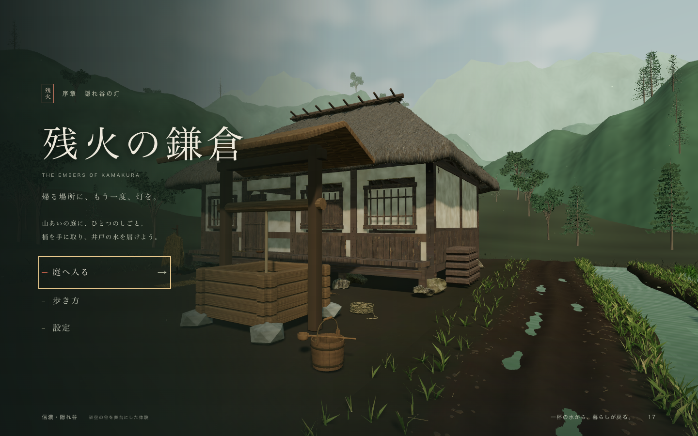

# 残火の鎌倉 — 隠れ谷の灯

山霧の谷を歩き、一杯の水を届ける、小さな3Dブラウザ体験。



```sh
npm start
```

`http://127.0.0.1:8080` を開きます。Node.js 18以上・WebGL2対応ブラウザが必要です。
依存インストール・ビルド・ログイン・外部CDNは不要です。

桶を拾う → 井戸で水をくむ → 縁側の前へ届ける。
WASD／矢印で移動、マウスで見回す、Eで操作、Escで一時停止。タッチにも対応します。

- [起動・操作・保存の詳しい説明](README_START_HERE.md)
- [SDDの要件](.kiro/specs/valley-water-carry/requirements.md)・[設計](.kiro/specs/valley-water-carry/design.md)・[タスク](.kiro/specs/valley-water-carry/tasks.md)
- [テストとブラウザ確認](reports/VERIFICATION_JA.md)
- [素材の出典と取り扱い](docs/05_ASSETS_AND_LICENSES_JA.md)

```sh
npm test
npm run check
npm run smoke
```

私有プロジェクトです。Three.jsのMITライセンスは同梱ライブラリに適用されます。
独自素材を含むプロジェクト全体の公開・再配布許可を表すものではありません。
