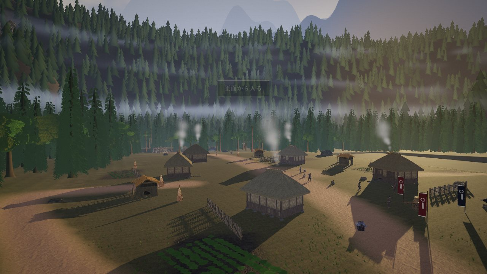

# 残火の鎌倉 — 隠れ谷の灯

1333年、鎌倉幕府が滅んだあと。信濃の隠れ谷で、旧臣の侍が、里を襲う追手と戦い、仲間とともに廃寺へ帰る。
ブラウザだけで遊べる三人称の時代劇アクションです（試作・第一章。所要10〜15分）。Three.js 製で、ビルドも依存パッケージも要りません。



> **English** — A third-person samurai action prototype that runs in the browser (Three.js, no build step, no npm dependencies).
> Chapter 1 of *Zanka no Kamakura* ("Embers of Kamakura"), about 10–15 minutes. Run `npm start` and open `/valley/index.html`.
> Code: MIT. Models, art and story: CC BY 4.0. The characters and props were generated with Meshy (AI); see [NOTICE.md](NOTICE.md).
> The UI and story are in Japanese.

## 遊ぶ

Node.js 18以上と、WebGL2に対応したブラウザが必要です。

```sh
git clone https://github.com/haranishi/kamakura-no-zanka.git
cd kamakura-no-zanka
npm start
```

表示された URL（既定は `http://127.0.0.1:8080`）に `/valley/index.html` を足して開きます。トップの `/` は前作（庭で水を運ぶ v18）です。
初回は約90MBのモデルを読み込みます。

操作：WASD 歩き／Shift 走り／C 屈み／左クリック 斬り（続けて三連）／F 強斬り／右クリック 受け（敵の刃が光ったら、見てから押すと弾き）／
Space 転がり／E 調べる・とどめ・闇討ち／Tab 敵を狙う／Q 仲間へ指示／Esc 休止。

## 何ができるか

- **戦い**：構え（体力とは別のゲージ）が尽きた敵にとどめを刺せる。弾き→反撃→とどめがつながる。気づかれていない敵は背後から闇討ちできる。
- **任務**：廃寺→林道→見晴らし→里（正面から入るか、脇道を回るか）→縛られた弥十郎を解く→待ち伏せ→焚き火。選んだ道が、食糧・士気・里の信頼と、結果の文に効く。
- **世界**：低い逆光の夕景、谷の霧、川と橋と関所と山砦。人物7体と小道具は Meshy で生成し、Blender で動きを焼いた。

## 状態

試作です。確かめたのは、ヘッドレス Chrome（M4 Pro）と、Linux（Node 22・24）のテストです。
実機のマウス操作、音の聴感、実機の Safari・スマホ・Firefox は確かめていません。未確認のことは [検証記録](reports/VERIFICATION_V19_JA.md) に書いています。

## 作る・確かめる

```sh
npm test            # 規則・世界の整合
npm run check       # 配布物の検査
npm run smoke       # HTTP の検査
```

ブラウザの自動プレイと固定画角の撮影は、[tools/README-valley-qa.md](tools/README-valley-qa.md)（Playwright。任意）。
設計は [.kiro/specs/hidden-valley-slice/](.kiro/specs/hidden-valley-slice/)、物語は [docs/10_STORY_AND_DESIGN_JA.md](docs/10_STORY_AND_DESIGN_JA.md)、踏んだ罠は [design-app.md](.kiro/specs/hidden-valley-slice/design-app.md)。
前作の説明は [README_START_HERE.md](README_START_HERE.md)。

## 参加する

不具合の報告、実機での動作報告、文書の補足・翻訳、小さな修正を歓迎します。始め方は [CONTRIBUTING.md](CONTRIBUTING.md)。
作者は一人で、返信は不定期です。

## ライセンス

- コード：MIT（[LICENSE](LICENSE)）
- 3Dモデル・動き・画像・物語：CC BY 4.0（[LICENSE-ASSETS.md](LICENSE-ASSETS.md)）
- Three.js・Poly Haven・CMU のモーションなど：それぞれの条件（[NOTICE.md](NOTICE.md)）
